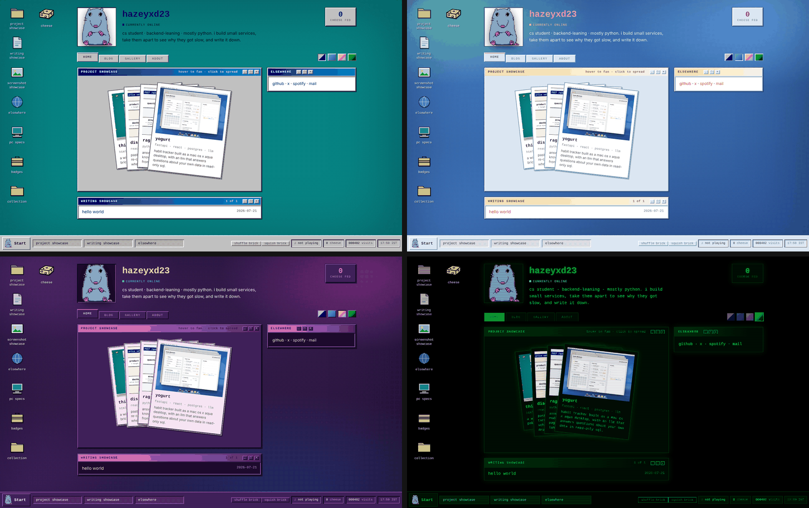

# hazeyxd23.github.io

My personal site, built as a little desktop operating system you can poke at.

**Live:** https://hazeyxd23.github.io



Plain HTML, CSS and JavaScript. No framework, no build tooling, no
dependencies — the only build step is a Python script that turns markdown into
blog pages, and it's standard library only.

## Why I built it this way

Most student portfolios are the same template with the names swapped out. They
tell you where someone worked and nothing about what they'd be like to work
with. I wanted mine to be the second thing.

So the site isn't a page — it's a desktop. Every panel is a real window you can
drag around, minimise to the taskbar, maximise, or close and reopen from the
Start menu or its desktop icon. There's a mascot, Brick, who you can drag
anywhere, feed blocks of cheese, and squish. None of that is necessary. That
is sort of the point: it's the part of a portfolio that can't be copied off a
template, because it only exists if someone decided to build it.

### On how it was built

I'm backend-leaning and I mostly write Python. I spent a weekend starting this
myself across a few different stacks, decided a portfolio wasn't the best place
to spend my time when I have actual projects to build, and made it with Claude
instead — directing the work, making the design calls, testing each pass and
sending it back with changes.

The interaction design, the Windows 98 direction, the palettes, the scope, and
every "no, do it this way" in here are mine. Most of the code is not. I'd
rather tell you that up front than have you assume otherwise and find out in an
interview.

If you want code I wrote line by line, the repos linked from the projects
window are the place to look. This one is a product decision rather than a code
sample — though knowing which of the two a problem calls for is worth something
as well.

No framework and no dependencies was my constraint, and it held: the only build
step is a Python script that turns markdown into blog pages.

### On the look

It's a Windows 98 desktop in four colour schemes. I grew up after that
era but the chunky, physical, obviously-clickable feel of it is nicer than most
of what replaced it, and it gave the whole thing one consistent idea to build
against rather than a pile of unrelated effects.

## What's in it

- **A window manager.** Drag by the title bar, minimise / maximise / close,
  taskbar buttons, a Start menu, right-click menus on the desktop and on window
  chrome, and desktop icons you can rearrange — positions persist between
  visits.
- **Four themes.** Three are the same interface in different colours; the
  fourth, matrix, is a deliberate outlier that looks nothing like them.
- **A blog** written in markdown and compiled to static pages by a ~70 line
  renderer in `build.py`.
- **A project stack** of polaroids that fans on hover and expands the whole
  window when clicked, with each card linking out to its repo.
- **Brick**, and the cheese.


## Running it locally

```bash
python3 -m http.server 8000     # then open localhost:8000
```

Opening `index.html` directly works too, but a server is closer to how it
actually runs.

## How it's put together

```
index.html          structure only — no content lives here
css/style.css       all four themes, as CSS variable blocks
js/theme.js         restores the saved theme before first paint (all pages)
js/data.js          ← the content. projects, books, links, specs
js/posts.js         GENERATED from posts/ — don't edit
js/app.js           rendering, the window manager, brick, cheese
posts/              ← the blog, one markdown file per post
blog/               GENERATED post pages — don't edit
build.py            markdown → blog; --bundle makes a single-file copy
```

Two ideas do most of the work:

**Themes are variables, not stylesheets.** A theme is one block of custom
properties. `data-chrome` on `<html>` picks which set of window furniture
applies, so three of the four themes share a single block of chrome rules and
differ only in colour. Adding a theme means writing variables and picking a
chrome — you don't touch the chrome itself.

The whole Windows 98 look comes down to two of those variables:

```css
--raise: inset 2px 2px 0 var(--lite), inset -2px -2px 0 var(--dark);  /* sticks out */
--sink:  inset 2px 2px 0 var(--dark), inset -2px -2px 0 var(--lite);  /* pressed in */
```

Every button, panel and field is one of those two. There's no wallpaper image
anywhere either — the desktop is a CSS dither checker over a gradient, which is
the same trick a 256-colour display used to fake a colour it didn't have.

**Content is data.** Everything on the site comes out of `js/data.js` and
`posts/`. Adding a project is appending an object; adding a post is writing a
markdown file and running the build. The rendering code doesn't change.

## Adding content

**A project** — append to `projects` in `js/data.js`. The stack re-lays itself
out for any number of cards, and `url` is what the expanded view opens:

```js
{ title: "new thing", meta: "go · sqlite", color: "#5fd8cf",
  url: "https://github.com/…", note: "one line about it." }
```

**A post** — a markdown file in `posts/`, then `python3 build.py`. The filename
becomes the URL minus any leading date, so
`posts/2026-09-02-tcp-server-ram.md` becomes `blog/tcp-server-ram.html`.

```markdown
---
title: why my tcp server ate 4gb of ram
date: 2026-09-02
tags: [rust, notes]
summary: one line, used as the page description. optional.
draft: true
---

markdown goes here.
```

`draft: true` skips a post entirely — no page, no listing entry — so unfinished
things can sit in the folder. Tags become filter chips on their own. If you
delete or re-draft a post, the next build removes its stale page.

**Books, ratings, specs, badges, links** — same pattern, same file. The sidebar
counts compute themselves.

## Deploying

This folder is the repo root, because GitHub Pages serves from a repo's root
(or its `/docs`) and `index.html` has to be one of those.

```bash
python3 build.py        # only if posts/ changed
git add -A
git commit -m "..."
git push
```

Pages redeploys on push. If it stops updating, check **Settings → Pages**:
source *Deploy from a branch*, branch `main`, folder `/ (root)`.

## Credits

Brick's sprites are someone else's artwork — see [`CREDITS.md`](CREDITS.md).
Everything else here, including all the icons, is original.
