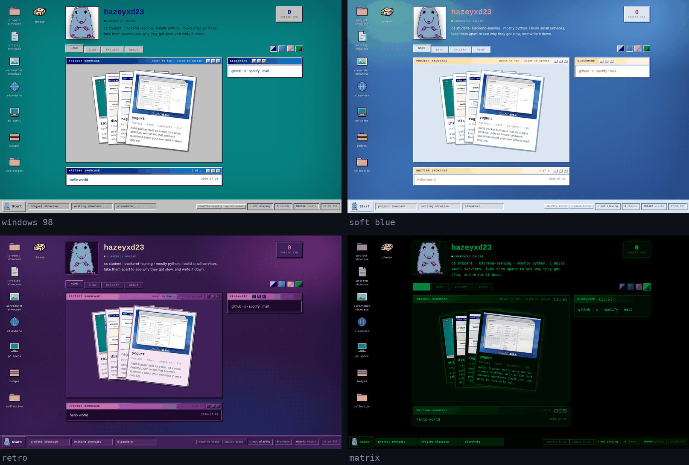
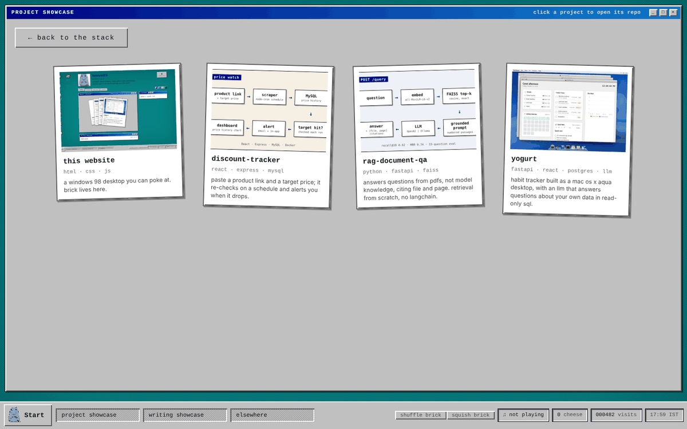

# hazeyxd23.github.io

My portfolio, built as a Windows 98 desktop you can poke at.

**Live:** https://hazeyxd23.github.io



Every panel is a real window: drag it, minimise it to the taskbar, maximise it,
or close it and reopen it from its desktop icon or the Start menu. Click the
project stack and the window grows to fill the screen, one card per repo.
There's a blog, four themes, and Brick, a mouse you can drag around, feed
cheese and squish.



## How it was built

I'm backend-leaning and mostly write Python, so I built this with Claude rather
than spend my own time on frontend. I directed it, made the design calls and
tested every pass. The design, the scope and the decisions are mine; most of the
code isn't. For code I wrote myself, see the projects the site links to.

My one constraint was no framework and no dependencies. It's plain HTML, CSS
and JavaScript, and the only build step is a standard-library Python script
that turns markdown into blog posts.

## Under the hood

- **Themes are CSS variables.** Three of the four share one set of Windows 98
  window rules and differ only in colour. The whole bevelled look comes down to
  two variables, `--raise` and `--sink`, and the desktop is a CSS dither
  pattern rather than a wallpaper image.
- **Content is data.** Projects, links, specs and the rest live in
  `js/data.js`; blog posts are markdown files in `posts/`.
- **The window manager** is `js/app.js`: dragging, the taskbar and Start menu,
  right-click menus, and desktop icons that remember where you put them.

## Running it

```bash
python3 -m http.server 8000    # then open localhost:8000
python3 build.py               # after adding or editing a post in posts/
```

To add a project, append an entry to `projects` in `js/data.js`. To add a post,
write `posts/YYYY-MM-DD-slug.md` with a short frontmatter block (`title`,
`date`, `tags`, and `draft: true` to keep it unpublished), then run the build.

## Credits

Brick's sprites are someone else's artwork; see [CREDITS.md](CREDITS.md).
Everything else, icons included, is original.
